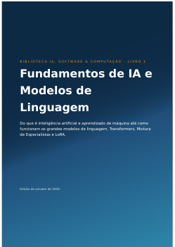
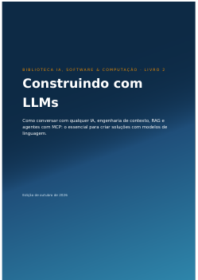
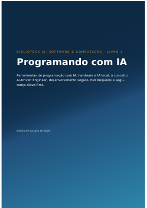
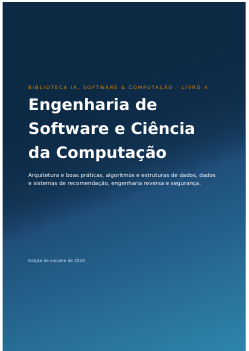
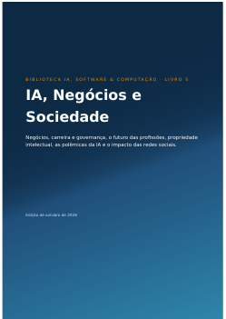
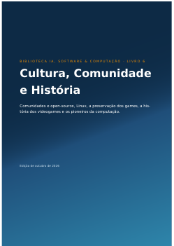

# 📚 Biblioteca IA, Software & Computação

Uma coleção gratuita de **6 livros em português** sobre inteligência artificial, desenvolvimento de software e computação. Os livros começam do zero, com explicações simples e analogias do dia a dia, e aprofundam aos poucos até o nível técnico.

O conteúdo reorganiza o que ensinam centenas de aulas e vídeos (do CS50 de Harvard a canais como IBM Technology e Anthropic), artigos técnicos de referência e o blog [AkitaOnRails](https://akitaonrails.com/), com pesquisa atualizada até **outubro de 2026**. Cada capítulo termina com uma tabela de fontes, com links.

## Baixe e leia

| | Livro | Temas | PDF |
|---|---|---|---|
|  | **Livro 1 — Fundamentos de IA e Modelos de Linguagem** | IA, machine learning, deep learning, LLMs, Transformers, Mistura de Especialistas (MoE), LoRA | [Baixar](livros/Livro1_Fundamentos_de_IA_e_Modelos_de_Linguagem.pdf) |
|  | **Livro 2 — Construindo com LLMs** | Prompts para qualquer IA, engenharia de contexto, RAG, agentes e MCP | [Baixar](livros/Livro2_Construindo_com_LLMs.pdf) |
|  | **Livro 3 — Programando com IA** | Ferramentas de código com IA, hardware e IA local, AI-Driven Engineer, desenvolvimento seguro e Pull Requests, segurança cloud-first | [Baixar](livros/Livro3_Programando_com_IA.pdf) |
|  | **Livro 4 — Engenharia de Software e Ciência da Computação** | Arquitetura e boas práticas, algoritmos, dados e recomendação, engenharia reversa e segurança | [Baixar](livros/Livro4_Engenharia_de_Software_e_Ciencia_da_Computacao.pdf) |
|  | **Livro 5 — IA, Negócios e Sociedade** | Negócios, carreira e governança, profissões, propriedade intelectual, polêmicas da IA, redes sociais | [Baixar](livros/Livro5_IA_Negocios_e_Sociedade.pdf) |
|  | **Livro 6 — Cultura, Comunidade e História** | Comunidades e open-source, Linux, preservação de games, história dos videogames, pioneiros da computação | [Baixar](livros/Livro6_Cultura_Comunidade_e_Historia.pdf) |

Os livros são independentes: comece por qualquer um. Para quem está começando do zero, a ordem sugerida é 1 → 2 → 3.

## Por dentro

- **Para começar**: cada capítulo e seção abre com uma explicação para leigos.
- **Você sabia?**: curiosidades técnicas e os grandes nomes da tecnologia.
- **Fontes**: vídeos citados pelo título com link, e tabelas de fontes com URL completa.
- **Datas**: preços, planos e benchmarks refletem out/2026 e trazem a data de verificação.

## Gerar os PDFs a partir do código-fonte

```bash
pip install weasyprint
cd fonte
python build_vols.py        # gera os 6 livros em livros/
python build_vols.py 3      # gera só o Livro 3
```

Os capítulos estão em `fonte/capitulos/` (HTML) e as figuras em `fonte/img/`.

## Licença

Texto e figuras próprias: [CC BY 4.0](https://creativecommons.org/licenses/by/4.0/deed.pt_BR). As fotos do Wikimedia Commons mantêm as licenças indicadas nas legendas. Vídeos, artigos e posts citados pertencem aos respectivos autores.

O conceito **AI-Driven Engineer** foi proposto por Marcus B. Silva ([@marcusbsilva](https://github.com/marcusbsilva)).
